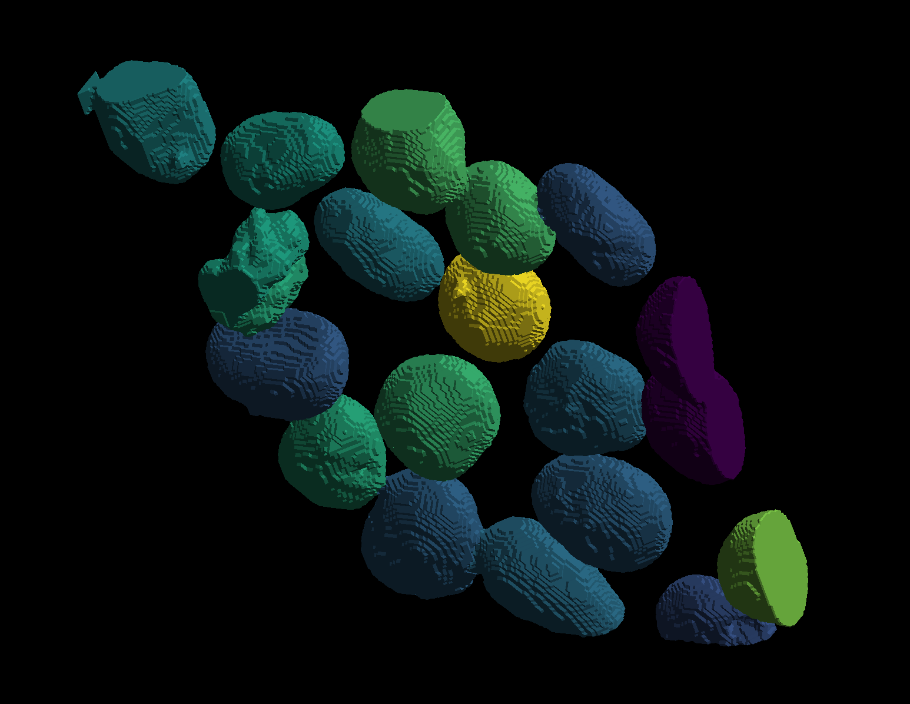

# napari-pykarambola

[](https://github.com/Ishihara-SynthMorph/napari-pykarambola/raw/main/LICENSE)
[](https://pypi.org/project/napari-pykarambola)
[](https://python.org)
[](https://github.com/Ishihara-SynthMorph/napari-pykarambola/actions)
[](https://codecov.io/gh/Ishihara-SynthMorph/napari-pykarambola)
[](https://napari-hub.org/plugins/napari-pykarambola)
[](https://napari.org/stable/plugins/index.html)
[](https://github.com/copier-org/copier)

Compute Minkowski tensors (shape and morphology descriptors) on segmented 3D objects

----------------------------------

`napari-pykarambola` is a thin [napari] widget around [pykarambola], a Python
implementation of the C++ [karambola] package for computing Minkowski
tensors — surface-integral shape descriptors from integral geometry — on 3D
triangulated meshes.
Point the widget at a `Labels` layer and it extracts a mesh for every
object (via marching cubes), computes its Minkowski tensors, and writes a
flat per-object scalar feature table to `labels_layer.features`.

### Why Minkowski tensors

Popular napari morphology tools such as [napari-skimage-regionprops]
compute descriptors like eccentricity, solidity, or Feret diameter, which
are fits to a reference shape (best-fit ellipsoid, convex hull) and work
best on simple, roughly-convex, blob-like 3D objects.
Minkowski tensors are surface integrals: they stay well-defined and
rotation-covariant regardless of topology, so they also work for
non-convex, high-genus, or branching objects where a best-fit-ellipsoid
description breaks down.
This plugin is meant to complement regionprops-style tools, not replace
them — reach for it when your objects are topologically complex and an
ellipsoid or convex-hull fit would throw away the shape information you
care about.

### What the widget outputs

The widget runs `pykarambola.api.minkowski_tensors_from_label_image` on the
chosen `Labels` layer and writes one row per label to
`labels_layer.features`, with a `label` column plus the following scalar
columns:

- **Base scalar functionals** — `w000`, `w100`, `w200`, `w300` (volume,
  surface area / 3, integrated mean curvature / 3, and 2π × Euler
  characteristic / 3 — see [pykarambola]'s README for the full
  normalization convention).
- **`*_beta`** — anisotropy index (ratio of smallest to largest eigenvalue
  magnitude) for each rank-2 tensor in the family `w020`, `w120`, `w220`,
  `w320`, `w102`, `w202`.
- **`*_trace`** — the matrix trace of each of those rank-2 tensors.
- **`*_trace_ratio`** — trace divided by the corresponding Minkowski
  scalar (e.g. `w020_trace_ratio = Tr(w020) / w000`).

Choosing `compute='standard'` restricts the widget to the base scalars and
their `w220`/`w102`/`w202`-derived quantities, while `compute='all'` adds
the full rank-2 tensor family above.
Full tensors, eigenvectors, and the per-degree `msm_ql`/`msm_wl`
spherical-harmonic arrays that pykarambola can also compute are
deliberately **not** flattened into the table — they don't fit as scalar
columns — so use pykarambola directly if you need those.

## Usage

1. Load a `Labels` layer (your own segmentation, or `File > Open Sample >
   napari-pykarambola > pykarambola sample labels` for a synthetic example
   with a near-spherical blob and a dumbbell shape, so you can immediately
   see a visible anisotropy difference in e.g. `w220_beta`).
2. Open the widget from napari's `Plugins` menu (or the `napari/layers/segment`
   menu), under **Minkowski tensors**.
3. Pick the `Labels` layer and a `compute` mode (`standard` or `all`).
4. Click **Compute Minkowski tensors**.

Results are written to the Labels layer's `features` table, viewable via
napari's built-in features/table viewer or exported to CSV from there.

### Visualizing as a Surface

After computing, pick a scalar from **Color surface by** (any column
written to `features`, e.g. `w220_beta`) and click **Visualize as
Surface** to add a `Surface` layer built from the same per-label meshes
`marching_cubes` already produced during the tensor computation — no
mesh is extracted twice. Each object's vertices are colored by that
object's scalar value, so e.g. coloring by `w220_beta` immediately shows
which objects are more anisotropic.

## Demo: real nuclei segmentation

The synthetic sample data (one sphere, one dumbbell) is good for a
quick sanity check, but a real segmentation makes the point better.
[`demo.py`] in this repo segments the nuclei channel of
[scikit-image's `cells3d`][cells3d] sample — the same dataset
[napari-skimage-regionprops] uses in its own tutorials — into ~19 real,
non-trivially-shaped nuclei via Gaussian smoothing, Otsu thresholding,
and a distance-transform watershed:

```bash
python demo.py
```

This opens napari with the membrane/nuclei channels and the resulting
`Labels` layer. From there:

1. Open **Minkowski tensors** from the `Plugins` menu, pick the `nuclei
   segmentation` layer, set `Compute` to `all`, and click **Compute
   Minkowski tensors**. Unlike the two-object synthetic sample,
   `w220_beta` now spreads meaningfully across real nuclei (roughly
   0.12 to 0.45 in a typical run), so it's a genuinely informative
   scalar to inspect.
2. Set **Color surface by** to `w220_beta` and click **Visualize as
   Surface**:

   

   Each nucleus is a uniform color (one value per label), and the
   spread of colors across the population reflects real shape
   variation — the yellow and purple nuclei above are the most
   anisotropic in this run.
3. For comparison, install [napari-skimage-regionprops] and run its
   `regionprops` widget on the same `nuclei segmentation` layer. It
   reports ellipsoid/hull-based descriptors (eccentricity, solidity,
   etc.) side by side with this plugin's topology-robust `w220_beta` —
   a direct illustration of the complementary relationship described
   below.

## Relationship to other napari plugins

- **[napari-skimage-regionprops]** — computes classic shape descriptors
  (eccentricity, solidity, Feret diameter, etc.); this plugin is a
  complementary source of topology-robust shape descriptors for objects
  where those ellipsoid/hull-based fits are less meaningful.
- **[napari-clusters-plotter]** — consumes per-object feature columns for
  dimensionality reduction and clustering (e.g. UMAP); the feature table
  written by this plugin follows the same `layer.features` contract, so
  Minkowski tensor columns can be clustered directly.
- **[napari-feature-classifier]** — provides random-forest-assisted
  annotation over a feature table that requires `label` and `roi_id`
  columns; this plugin's table already has `label`, but **not** `roi_id`
  yet, so a `roi_id` column would need to be added for full compatibility.

----------------------------------

This [napari] plugin was generated with [copier] using the [napari-plugin-template].

<!--
Don't miss the full getting started guide to set up your new package:
https://github.com/napari/napari-plugin-template#getting-started

and review the napari docs for plugin developers:
https://napari.org/stable/plugins/index.html
-->

## Installation

You can install `napari-pykarambola` via [pip]:

```bash
pip install napari-pykarambola
```

If napari is not already installed, you can install `napari-pykarambola` with napari and Qt via:

```bash
pip install "napari-pykarambola[all]"
```


To install latest development version:

```bash
pip install git+https://github.com/Ishihara-SynthMorph/napari-pykarambola.git
```


## Contributing

Contributions are very welcome. Tests can be run with [tox], please ensure
the coverage at least stays the same before you submit a pull request.

## License

Distributed under the terms of the [BSD-3] license,
"napari-pykarambola" is free and open source software

## Issues

If you encounter any problems, please [file an issue] along with a detailed description.

[napari]: https://github.com/napari/napari
[copier]: https://copier.readthedocs.io/en/stable/
[pykarambola]: https://github.com/Ishihara-SynthMorph/pykarambola
[karambola]: https://github.com/morphometry/karambola
[`demo.py`]: demo.py
[cells3d]: https://scikit-image.org/docs/stable/api/skimage.data.html#skimage.data.cells3d
[napari-skimage-regionprops]: https://github.com/haesleinhuepf/napari-skimage-regionprops
[napari-clusters-plotter]: https://github.com/BiAPoL/napari-clusters-plotter
[napari-feature-classifier]: https://github.com/fractal-napari-plugins-collection/napari-feature-classifier
[MIT]: http://opensource.org/licenses/MIT
[BSD-3]: http://opensource.org/licenses/BSD-3-Clause
[GNU GPL v3.0]: http://www.gnu.org/licenses/gpl-3.0.txt
[GNU LGPL v3.0]: http://www.gnu.org/licenses/lgpl-3.0.txt
[Apache Software License 2.0]: http://www.apache.org/licenses/LICENSE-2.0
[Mozilla Public License 2.0]: https://www.mozilla.org/media/MPL/2.0/index.txt
[napari-plugin-template]: https://github.com/napari/napari-plugin-template

[file an issue]: https://github.com/Ishihara-SynthMorph/napari-pykarambola/issues

[tox]: https://tox.readthedocs.io/en/latest/
[pip]: https://pypi.org/project/pip/
[PyPI]: https://pypi.org/
